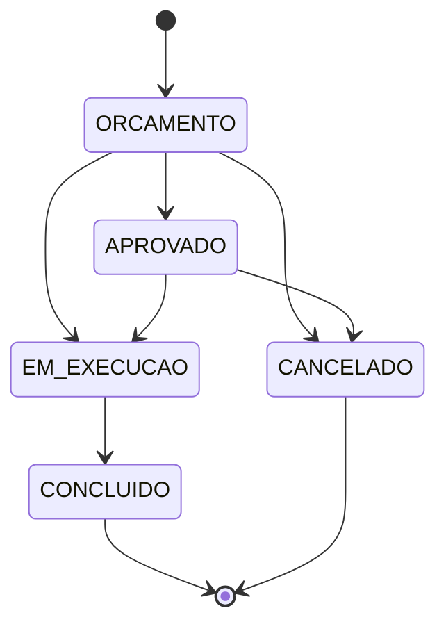
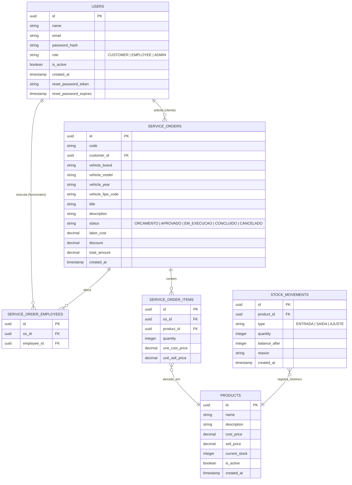
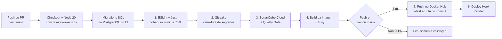

# 🚗 AutoShop ERP: Sistema de Gerenciamento de Oficina Mecânica

O **AutoShop ERP** é um sistema desenvolvido em Node.js projetado para automatizar, organizar e otimizar os processos operacionais e administrativos de oficinas mecânicas. O sistema contém os serviços de controle do estoque de produtos, abertura de Ordens de Serviço (OS), rastreabilidade de movimentações, consulta de dados automotivos oficiais e um dashboard de gestão empresarial.

---

## 📑 Sumário

- [🎯 Visão Geral do Sistema](#-visão-geral-do-sistema)
- [👤 Perfis de Acesso e Regras de Negócio](#-perfis-de-acesso-e-regras-de-negócio)
  - [1. Cliente (Usuário Comum: `CUSTOMER`)](#1-cliente-usuário-comum-customer)
  - [2. Funcionário (`EMPLOYEE`)](#2-funcionário-employee)
  - [3. Administrador (`ADMIN`)](#3-administrador-admin)
- [📐 Regras de Negócio do Domínio](#-regras-de-negócio-do-domínio)
- [🌐 Integrações com APIs Externas](#-integrações-com-apis-externas)
  - [1. API Tabela FIPE](#1-api-tabela-fipe)
  - [2. Nodemailer](#2-nodemailer-httpsnodemailercom-serviço-de-e-mail)
- [🏗️ Arquitetura de Software e Estrutura de Pastas](#️-arquitetura-de-software-e-estrutura-de-pastas)
- [🗄️ Modelagem do Banco de Dados (DER)](#️-modelagem-do-banco-de-dados-der)
- [📡 Documentação dos Endpoints](#-documentação-dos-endpoints)
- [🛠️ Infraestrutura e Pipeline DevOps (CI/CD)](#️-infraestrutura-e-pipeline-devops-cicd)
  - [Etapas da pipeline](#etapas-da-pipeline)
  - [Funcionamento do Quality Gate](#funcionamento-do-quality-gate)
  - [Decisões de segurança](#decisões-de-segurança)
  - [Fluxo de branches](#fluxo-de-branches)
  - [Secrets necessários](#secrets-necessários)
- [🐳 Containerização (Docker)](#-containerização-docker)
- [💻 Pré-requisitos e Ambiente](#-pré-requisitos-e-ambiente)
- [🚀 Guia de Configuração e Execução](#-guia-de-configuração-e-execução)
- [🌐 Ambiente de Produção](#-ambiente-de-produção)
- [📬 Coleção de Requisições (Postman)](#-coleção-de-requisições-postman)
- [🧪 Scripts Disponíveis](#-scripts-disponíveis)
- [🔭 Melhorias Futuras](#-melhorias-futuras)

---

## 🎯 Visão Geral do Sistema

Oficinas mecânicas frequentemente enfrentam dificuldades para acompanhar o andamento dos consertos dos veículos, mostrar preços claros, controlar o estoque de peças e avaliar o trabalho da equipe. Com isso, para resolver esses problemas, o **AutoShop ERP** integra três pilares essenciais:

1. **Atendimento ao Cliente e Transparência:** Permite que o cliente acompanhe o histórico e o status de sua Ordem de Serviço (OS), recebendo um aviso por e-mail assim que o conserto é finalizado.
2. **Operacional e Controle de Estoque:** Facilita o registro de peças, serviços e mecânicos responsáveis em cada atendimento, além de garantir que toda peça vinculada a uma OS seja descontada do estoque automaticamente, com histórico de cada movimentação.
3. **Gestão e Controle Financeiro:** Oferece ao administrador um dashboard com o panorama de usuários, estoque e Ordens de Serviço por status, além das métricas financeiras de faturamento, receita de mão de obra e valor imobilizado em estoque.

**Escopo:** o sistema cobre o ciclo completo de uma oficina (cadastro de clientes e produtos, orçamento, execução e conclusão da OS, controle de estoque e gestão administrativa). Não há front-end: a API é consumida via Postman ou por qualquer cliente HTTP.

## 👤 Perfis de Acesso e Regras de Negócio

A aplicação utiliza controle de acesso baseado em papéis (Role-Based Access Control - RBAC) através de JSON Web Tokens (JWT), na qual os usuários são categorizados em três perfis estratégicos. O papel (`role`) vai dentro do token e é verificado em duas camadas: no middleware da rota (`checkRole`) e novamente dentro do caso de uso.

### 1. Cliente (Usuário Comum: `CUSTOMER`)
- **Ações Permitidas:** 
  - Criar seu próprio perfil no sistema com nome, e-mail e senha.
  - Autenticar-se (Login/Logout) e solicitar redefinição de senha via e-mail.
  - Consultar e atualizar o seu próprio cadastro.
  - Consultar o catálogo de produtos ativos (sem o preço de custo).
  - Visualizar o histórico de suas próprias Ordens de Serviço, checando detalhes como título, descrição, status atual, preço de mão de obra, produtos aplicados, desconto concedido e valor total.
- **Regras de Negócio e Restrições:** 
  - O cliente possui acesso estritamente de leitura às suas Ordens de Serviço.
  - Não possui permissão para visualizar dados de outros clientes, movimentações de estoque, preço de custo ou métricas operacionais.
  - O auto-cadastro **sempre** gera um usuário `CUSTOMER`, mesmo que o corpo da requisição envie outro `role` (impede escalonamento de privilégio).

### 2. Funcionário (`EMPLOYEE`)
- **Ações Permitidas:** 
  - Autenticar-se e redefinir sua própria senha.
  - Cadastrar clientes (caso o cliente prefira que a oficina faça o primeiro registro), além de consultar, atualizar e desativar clientes.
  - Criar, gerenciar e excluir Ordens de Serviço (alterar status entre *ORCAMENTO*, *APROVADO*, *EM_EXECUCAO*, *CONCLUIDO*, *CANCELADO*).
  - Consultar dados da Tabela FIPE para preenchimento ágil e padronizado do veículo na OS.
  - Vincular peças às Ordens de Serviço e atribuir os mecânicos responsáveis.
  - Gerenciar produtos e cadastrar, corrigir ou remover movimentações de estoque.
- **Regras de Negócio e Restrições:** 
  - Um funcionário **não pode** criar contas de outros funcionários ou administradores, e ao cadastrar um usuário, o perfil é sempre `CUSTOMER`.
  - Só enxerga, edita e desativa usuários do tipo cliente (e o próprio cadastro).
  - O cliente cadastrado pela oficina pode definir a sua própria senha a qualquer momento pelo fluxo “Esqueci minha senha” (`POST /auth/forgot-password`).
  - Não possui acesso ao Dashboard Financeiro da administração.

### 3. Administrador (`ADMIN`)
- **Ações Permitidas:** 
  - Executar todas as funções permitidas aos funcionários e clientes.
  - Criar e gerenciar contas corporativas de novos funcionários e outros administradores (enviando o campo `role` no cadastro), alterar o cargo e ativar ou desativar qualquer usuário.
  - Acessar o **Dashboard Administrativo**, que fornece métricas de:
    - Usuários ativos e inativos por perfil.
    - Quantidade total de OSs e contagem por status.
    - Lista de produtos ativos com o estoque atual de cada um.
    - Receita bruta e receita de mão de obra das OSs concluídas.
    - Valor total imobilizado em estoque (quantidade × preço de custo).
- **Regras de Negócio e Restrições:** 
  - O perfil de Administrador é restrito e somente um `ADMIN` autenticado consegue atribuir os papéis `EMPLOYEE` ou `ADMIN`.
  - Contas administrativas são criadas por outro administrador e nunca por auto-cadastro, e também os administradores iniciais vêm do seed do banco.
  - A senha inicial é definida por quem cria a conta, e o dono da conta pode trocá-la pelo fluxo de recuperação de senha.

---

## 📐 Regras de Negócio do Domínio

**Ciclo de vida da Ordem de Serviço**



Qualquer transição fora desse diagrama retorna `422`. `CONCLUIDO` e `CANCELADO` são estados finais.

**Regras da OS**
- Toda OS nasce como `ORCAMENTO`, com código sequencial por ano (`OS-2026-001`, `OS-2026-002`...) gerado dentro de uma transação para evitar duplicidade.
- O desconto não pode ser maior que o subtotal e o total é recalculado a cada item adicionado ou removido,`total_amount = labor_cost + soma(quantidade × preço de venda dos itens) − discount`.
- **Preço congelado:** ao vincular uma peça, o custo e o preço de venda do produto naquele momento são copiados para o item. Alterações futuras no produto não mudam OSs antigas.
- Peças e funcionários só podem ser adicionados ou removidos enquanto a OS **não** estiver `CONCLUIDO` ou `CANCELADO`.
- Só `EMPLOYEE` ou `ADMIN` podem ser alocados como responsáveis por executar uma OS, sem repetir o mesmo funcionário na mesma OS.
- Ao mudar o status para `CONCLUIDO`, o cliente recebe um e-mail avisando que o veículo está pronto.
- Clientes só enxergam as próprias OSs e não enxergam o preço de custo dos itens, que é restrito para funcionários e administradores.

**Regras de estoque**
- Vincular uma peça à OS gera automaticamente uma movimentação `SAIDA` (`"Uso na Ordem de Serviço OS-..."`), com bloqueio de linha (`FOR UPDATE`) para evitar condição de corrida. Sem produtos o suficiente, a operação retorna `422`.
- Remover um item ou excluir a OS gera uma movimentação `ENTRADA` de estorno.
- Movimentações manuais: `ENTRADA` soma, `SAIDA` subtrai (o saldo nunca fica negativo) e `AJUSTE` define o saldo exatamente igual à quantidade informada, só troca outras informações. Cada movimentação guarda o `balance_after`.
- Editar ou excluir uma movimentação recalcula o saldo do produto e é recusado se o resultado for negativo.
- O campo `current_stock` **não** pode ser alterado por `PUT /products/:id`, todo ajuste de estoque passa por uma movimentação, garantindo rastreabilidade.
- Criar um produto com estoque inicial maior que zero registra uma `ENTRADA` (`"Estoque inicial de cadastro"`).

---

### Endpoints e Operações (CRUD)

| Entidade | Métodos HTTP / Operações | Regras de Negócio e Descrição |
| --- | --- | --- |
| **Usuários** | `POST`, `GET`, `PUT`, `DELETE` (Lógico) | Gerencia clientes, funcionários e administradores. A exclusão é lógica (`is_active = false`), fazendo com que o usuário perca o acesso ao login e preserve o histórico nas Ordens de Serviço. |
| **Produtos** | `POST`, `GET`, `PUT`, `DELETE` (Lógico) | Gerencia o catálogo de peças. A exclusão é lógica (`is_active = false`), inativando o item no catálogo de vendas e mantendo a integridade referencial nas OSs anteriores. |
| **Ordens de Serviço** | `POST`, `GET`, `PUT` (`/:id` e `/:id/status`), `DELETE` | Utiliza requisições `PUT` tanto para a edição completa da OS quanto para a alteração específica de status. A exclusão física remove o registro com estorno de estoque. |
| **Itens e Funcionários da OS** | `POST` (Adição), `DELETE` (Remoção) | Sub-recursos vinculados diretamente a uma Ordem de Serviço específica (`/:id/items` e `/:id/employees`), permitindo o gerenciamento e alocação de peças e funcionários. |
| **Movimentações de Estoque** | `POST`, `GET`, `PUT`, `DELETE` | Registra e gerencia as entradas, saídas e ajustes de estoque associados aos produtos, aplicando reflexos diretos no saldo. |
| **Dashboard / FIPE** | `GET` | Módulos de consulta analítica e integração com a API FIPE para consulta de veículos e preços. |

---

## 🌐 Integrações com APIs Externas

O projeto integra duas APIs externas essenciais para agregar valor real ao sistema:

### 1. API Tabela FIPE ([`https://fipe.api.br/`](https://fipe.api.br/))
- **Serviço:** API pública da Tabela FIPE (Parallelum), base `https://fipe.parallelum.com.br/api/v2`. O projeto não exige chave de API nem variável de ambiente para ela.
- **Finalidade no Projeto:** Agilizar e padronizar o processo de abertura de Ordens de Serviço, evitando erros humanos no cadastro dos veículos na OS.
- **Como Funciona:** Durante o cadastro de uma nova OS, o funcionário consulta pelo AutoShop ERP as marcas, modelos e anos cadastrados na Tabela FIPE nacional e usa esses dados para preencher `vehicle_brand`, `vehicle_model`, `vehicle_year` e `vehicle_fipe_code` da OS, buscando o veículo pela placa ( existe um caminho com marcas e tipos também). Isso evita erros de conhecimento humano sobre um carro, para que a oficina não erre na hora de comprar ou usar peças para atender a OS.
- **Tratamento de falhas:** placa ou código FIPE em formato inválido retornam `400`, e registro inexistente retorna `404`, já indisponibilidade da API externa retorna `502`.

| Rota | Função |
| :--- | :--- |
| `GET /fipe/plate/:plate` | Consulta o veículo pela placa (formato antigo ou Mercosul). |
| `GET /fipe/brands?type=` | Lista as marcas. |
| `GET /fipe/brands/:brandId/models?type=` | Lista os modelos de uma marca. |
| `GET /fipe/brands/:brandId/models/:modelId/years?type=` | Lista os anos de um modelo. |
| `GET /fipe/price?type=&brandId=&modelId=&yearId=` | Preço FIPE por marca, modelo e ano. Alternativa: `fipeCode=` e `yearId=`. |

### 2. Nodemailer ([`https://nodemailer.com/`](https://nodemailer.com/)): Serviço de E-mail
- **Finalidade no Projeto:** Comunicação com os usuários para segurança e notificações operacionais.
- **Casos de Uso Integrados:**
  1. **Recuperação de Senha Segura:** `POST /auth/forgot-password` gera um token aleatório de 32 bytes (`crypto.randomBytes`), válido por **15 minutos** e de **uso único**, e o envia por e-mail. A senha só é trocada com `POST /auth/reset-password` informando o token e a nova senha. Sem o token recebido no e-mail da própria conta, ninguém consegue assumir a conta de outra pessoa.
  2. **Notificação de Conclusão de Serviço:** Quando uma Ordem de Serviço muda seu status para `CONCLUIDO`, o sistema dispara automaticamente um e-mail informando o cliente de que o veículo está pronto para retirada, com o código da OS, o veículo e o valor total.
- **Observação:** o e-mail de recuperação traz o token em destaque e também um link para `BASE_URL/auth/reset-password?token=...`. Como a API não possui front-end, é preciso copiar o token do e-mail e envia-lo no corpo do `POST /auth/reset-password`.

---

## 🏗️ Arquitetura de Software e Estrutura de Pastas

A aplicação foi desenhada seguindo os princípios da **Clean Architecture** (Arquitetura Limpa), dividindo as responsabilidades em camadas bem delimitadas para isolar as regras de negócio de detalhes de infraestrutura (como banco de dados, frameworks web e APIs externas).

```text
autoShop-erp/
├── .github/workflows/        # Pipeline de CI/CD (GitHub Actions): ci-cd.yaml
├── database/
│   ├── migrations/           # 01_init_schema.sql, 02_add_password_recovery_columns.sql
│   └── seeds/                # 01_reset_and_populate.sql (dados de demonstração)
├── docs/                     # Collection do Postman
├── src/
│   ├── domain/               # [Camada Central] Regras de Negócio Puras
│   │   ├── entities/         # User, Product, ServiceOrder, ServiceOrderItem, ServiceOrderEmployee, StockMovement
│   │   ├── contracts/        # Interfaces (IUserRepository, IEmailService, IFipeService, ITokenService, ITransactionManager...)
│   │   ├── errors/           # Erros de negócio tipados (DomainErrors.js)
│   │   └── validators.js     # Validações reutilizáveis (UUID, e-mail, senha, valores)
│   │
│   ├── use-cases/            # [Casos de Uso] Orquestração das regras de negócio
│   │   ├── auth/             # Login e recuperação de senha
│   │   ├── user/             # Gerenciamento de usuários
│   │   ├── service-order/    # Ordens de Serviço, itens, funcionários e status
│   │   ├── product/          # Produtos
│   │   ├── stock/            # Movimentações de estoque
│   │   ├── fipe/             # Consulta à Tabela FIPE
│   │   └── dashboard/        # Relatórios administrativos
│   │
│   ├── adapters/             # [Adaptadores] Interface entre o mundo externo e os use cases
│   │   ├── controllers/      # Controladores HTTP que tratam requisições/respostas
│   │   └── presenters/       # Formatação e sanitização de dados de saída
│   │
│   ├── infrastructure/       # [Infraestrutura] Frameworks, Bancos e Serviços
│   │   ├── database/         # Pool PostgreSQL (driver nativo 'pg') e gerenciador de transações
│   │   ├── external-services/# Clientes das APIs externas (fipe/FipeService, mail/EmailService)
│   │   ├── http/             # Rotas Express (composição das dependências) e middlewares
│   │   ├── repositories/     # Implementação concreta dos repositórios em SQL (Postgres*)
│   │   └── security/         # JwtTokenService (JWT e bcrypt)
│   │
│   └── server.js             # Ponto de entrada: monta o Express e os middlewares globais
│
├── tests/
│   ├── unit/                 # Testes unitários (use cases, services e presenters)
│   └── integration/          # Testes de integração dos endpoints HTTP (supertest + PostgreSQL)
│
├── .env.example              # Modelo de variáveis de ambiente
├── .dockerignore
├── docker-compose.yml        # Orquestração do banco e da aplicação
├── Dockerfile                # Build otimizado em múltiplos estágios (Multi-stage)
├── eslint.config.js          # Regras do ESLint
├── jest.config.js            # Jest com limite mínimo de cobertura de 70%
├── sonar-project.properties  # Configuração do SonarQube Cloud
├── package.json              # Dependências e scripts do projeto
└── README.md                 # Documentação principal do repositório
```

**Como as dependências são organizadas**
- A seta de dependência aponta sempre para dentro: `infrastructure` → `adapters` → `use-cases` → `domain`. As camadas internas não importam nada das externas.
- Os casos de uso dependem de **contratos** (`domain/contracts`) e nunca de implementações. Por exemplo, `ServiceOrderUseCase` recebe repositórios, o serviço de e-mail e o gerenciador de transações pelo construtor, sem saber que existem PostgreSQL ou Nodemailer.
- A infraestrutura implementa os contratos (`PostgresUserRepository`, `EmailService`, `FipeService`, `JwtTokenService`, `PostgresTransactionManager`). A injeção é manual, feita nos arquivos de rota (`infrastructure/http/routes`), que funcionam como a composição das dependências.
- Isso permite trocar o banco, o provedor de e-mail ou a API de veículos sem alterar regras de negócio, e testar os casos de uso isoladamente.

**Tratamento global de erros**
- Os casos de uso lançam erros tipados que não conhecem HTTP (`ValidationError`, `AuthenticationError`, `NotFoundError`, `BusinessRuleError`, `InsufficientStockError`, `ExternalServiceError`).
- O middleware global `errorHandler` (registrado por último no `server.js`, junto com o `notFoundHandler`) traduz cada erro em status HTTP e devolve sempre o mesmo formato, sem expor stack trace ou detalhes internos:

```json
{ "status": "error", "message": "Descrição do problema." }
```

| Status | Quando ocorre |
| :---: | :--- |
| `200` / `201` | Sucesso / recurso criado |
| `400` | Validação de dados, ID malformado ou JSON inválido |
| `401` | Token ausente, inválido ou expirado; credenciais inválidas; conta desativada |
| `403` | Perfil sem permissão para a operação |
| `404` | Recurso, rota, e-mail ou token de recuperação não encontrado |
| `422` | Regra de negócio violada (estoque insuficiente, transição de status inválida, e-mail duplicado...) |
| `502` | Falha na API externa da Tabela FIPE |
| `500` | Erro inesperado (mensagem genérica; o detalhe fica apenas no log do servidor) |

---

## 🗄️ Modelagem do Banco de Dados (DER)

A persistência de dados utiliza o banco relacional **PostgreSQL**, a qual foi modelada para garantir integridade referencial, rastreabilidade completa de histórico de estoque e alocação flexível de equipes de trabalho em Ordens de Serviço. O schema é criado pelos arquivos SQL de `database/migrations`, sem ORM.



**Entidades de negócio**

| Entidade | Papel no sistema |
| :--- | :--- |
| `USERS` | Clientes, funcionários e administradores em uma única tabela, diferenciados pelo `role`, guarda também o token temporário de recuperação de senha. |
| `PRODUCTS` | Catálogo de peças e insumos, com preço de custo, preço de venda e saldo atual. |
| `SERVICE_ORDERS` | Ordem de Serviço, contém dados de cliente, veículo (dados da FIPE), status e valores. |
| `STOCK_MOVEMENTS` | Histórico de moviemntação do estoque, toda entrada, saída ou ajuste, com o saldo resultante. |
| `SERVICE_ORDER_ITEMS` | Peças usadas em uma OS, com preços congelados no momento da inclusão, relaciona OS e produtos. |
| `SERVICE_ORDER_EMPLOYEES` | Mecânicos alocados em uma OS, relaciona OS e funcionários (equipe de N pessoas por OS). |


---


## 📡 Documentação dos Endpoints

**Autenticação:** envie o token obtido no login no cabeçalho `Authorization: Bearer <token>`. Ele expira conforme o tempo definido em `JWT_EXPIRES_IN`.

**Legenda de permissões**

| Permissão | Significado |
| :--- | :--- |
| **Pública** | Não precisa de token. |
| **Logado** | Qualquer perfil com token válido, a regra por perfil está descrita na explicação. |
| **ADMIN** | Somente administradores. |
| **EMPLOYEE** | Somente funcionários. |
| **CUSTOMER** | Somente clientes. |
| **EMPLOYEE e ADMIN** | Somente funcionários e administradores, cliente recebe `403`. |

### Sistema

| MÉTODO | ROTA | Explicação | Permissão |
| :--- | :--- | :--- | :--- |
| GET | `/` | Página inicial, confirma que a API está no ar. | Pública |
| GET | `/db` | Testa a conexão com o banco e informa o tempo de resposta. | Pública |

### Autenticação

| MÉTODO | ROTA | Explicação | Permissão |
| :--- | :--- | :--- | :--- |
| POST | `/auth/login` | Autentica com e-mail e senha e devolve o usuário e o token JWT. | Pública |
| POST | `/auth/logout` | Encerra a sessão (o JWT é stateless: o cliente deve descartar o token). | Logado |
| POST | `/auth/forgot-password` | Gera o token de recuperação e o envia por e-mail. | Pública |
| POST | `/auth/reset-password` | Define a nova senha usando o token recebido por e-mail. | Pública |

### Usuários

| MÉTODO | ROTA | Explicação | Permissão |
| :--- | :--- | :--- | :--- |
| POST | `/users/cadastro` | Cadastra um usuário, o perfil é sempre `CUSTOMER`. Só um `ADMIN` logado pode definir `role`. | Pública |
| GET | `/users` | Lista usuários com filtros `name`, `email`, `role` e `isActive`. `EMPLOYEE` enxerga apenas clientes. | EMPLOYEE e ADMIN |
| GET | `/users/:id` | Busca um usuário. `CUSTOMER` só acessa o próprio e `EMPLOYEE` acessa só clientes ou o próprio, já `ADMIN` acessa todos. | Logado |
| PUT | `/users/:id` | Atualiza `name`, `email`, `role`, `isActive`. `CUSTOMER` só altera o próprio cadastro, `EMPLOYEE` altera clientes, apenas `ADMIN` altera o `role`. | Logado |
| DELETE | `/users/:id` | Desativa o usuário (exclusão lógica). `EMPLOYEE` só desativa clientes e `ADMIN` desativa qualquer um. | EMPLOYEE e ADMIN |

### Produtos

| MÉTODO | ROTA | Explicação | Permissão |
| :--- | :--- | :--- | :--- |
| GET | `/products` | Lista produtos. Visitantes e clientes veem só ativos e sem `cost_price`, funcionários e admins veem todos, com custo. | Público |
| GET | `/products/:id` | Busca um produto e produtos inativos retornam `403` para visitantes e clientes. | Público |
| POST | `/products` | Cadastra um produto. | EMPLOYEE e ADMIN |
| PUT | `/products/:id` | Atualiza dados do produto. Se enviar `current_stock` retorna `400` (use movimentação de estoque). | EMPLOYEE e ADMIN |
| DELETE | `/products/:id` | Inativa o produto (exclusão lógica). | EMPLOYEE e ADMIN |

### Ordens de Serviço

| MÉTODO | ROTA | Explicação | Permissão |
| :--- | :--- | :--- | :--- |
| POST | `/service-orders` | Abre uma OS (nasce como `ORCAMENTO`, com código `OS-AAAA-NNN`). | EMPLOYEE e ADMIN |
| GET | `/service-orders` | Lista OSs, com filtros `status` e `customer_id`. `CUSTOMER` vê apenas as próprias. | Logado |
| GET | `/service-orders/:id` | Detalha uma OS com itens e funcionários. `CUSTOMER` só acessa as próprias. | Logado |
| PUT | `/service-orders/:id/status` | Altera o status seguindo o [ciclo de vida](#-regras-de-negócio-do-domínio). Em `CONCLUIDO`, envia e-mail ao cliente. | EMPLOYEE e ADMIN |
| PUT | `/service-orders/:id` | Atualiza dados da OS. Produtos e Funcionários adicionados não são alterado aqui, existe outra rota para eles. | EMPLOYEE e ADMIN |
| DELETE | `/service-orders/:id` | Exclui a OS e estorna o estoque dos itens. Não permitido se `CONCLUIDO`. | EMPLOYEE e ADMIN |
| POST | `/service-orders/:id/items` | Vincula uma peça, baixa o estoque, congela preços e recalcula o total. | EMPLOYEE e ADMIN |
| DELETE | `/service-orders/:id/items/:itemId` | Remove a peça da OS, estorna o estoque e recalcula o total. | EMPLOYEE e ADMIN |
| POST | `/service-orders/:id/employees` | Aloca um mecânico responsável na OS. | EMPLOYEE e ADMIN |
| DELETE | `/service-orders/:id/employees/:employeeId` | Remove a alocação do mecânico. | EMPLOYEE e ADMIN |

### Estoque

| MÉTODO | ROTA | Explicação | Permissão |
| :--- | :--- | :--- | :--- |
| GET | `/stock` | Lista todas as movimentações de estoque do sistema. | EMPLOYEE e ADMIN |
| POST | `/stock/products/:id/stock` | Registra uma movimentação manual (`ENTRADA`, `SAIDA` ou `AJUSTE`) para o produto. | EMPLOYEE e ADMIN |
| GET | `/stock/products/:id/stock-movements` | Histórico de movimentações de um produto. | EMPLOYEE e ADMIN |
| PUT | `/stock/:id` | Edita uma movimentação e recalcula o saldo do produto. | EMPLOYEE e ADMIN |
| DELETE | `/stock/:id` | Remove a movimentação e estorna o seu efeito no saldo. | EMPLOYEE e ADMIN |

### Tabela FIPE

| MÉTODO | ROTA | Explicação | Permissão |
| :--- | :--- | :--- | :--- |
| GET | `/fipe/plate/:plate` | Consulta o veículo pela placa. | Logado |
| GET | `/fipe/brands` | Lista as marcas (`?type=cars`, `motorcycles` ou `trucks`). | Logado |
| GET | `/fipe/brands/:brandId/models` | Lista os modelos da marca. | Logado |
| GET | `/fipe/brands/:brandId/models/:modelId/years` | Lista os anos disponíveis do modelo. | Logado |
| GET | `/fipe/price` | Preço FIPE: `?brandId=&modelId=&yearId=` ou `?fipeCode=&yearId=`. | Logado |

---

## 🛠️ Infraestrutura e Pipeline DevOps (CI/CD)

O projeto conta com um pipeline automatizado configurado via **GitHub Actions** (`.github/workflows/ci-cd.yaml`), em um único job (`ci-cd-pipeline`, `ubuntu-latest`) com etapas **sequenciais**, se uma etapa falha, todas as seguintes são interrompidas e nada é publicado.

**Gatilhos:** `push` e `pull_request` nas branches `dev` e `main`. Pull requests executam toda a validação (lint, testes, segredos, SonarQube e varredura da imagem), mas **não** publicam imagem nem fazem deploy, quem faz isso é só o push quando o merge realmente acontece.



### Etapas da pipeline

**Preparação do ambiente**
- `actions/checkout` com `fetch-depth: 0` (histórico completo, necessário para o Gitleaks e para o Sonar).
- Node.js 20 com cache do npm e instalação com `npm ci --ignore-scripts` (instalação reprodutível a partir do `package-lock.json` e sem executar scripts de pacotes de terceiros).
- Um container de serviço `postgres:15-alpine` sobe junto com o job, com *health check*, para os testes de integração rodarem com banco real. As variáveis de teste são definidas no próprio workflow e os dados SMTP vêm dos *secrets* do GitHub.
- Os dois arquivos de `database/migrations` são aplicados com `psql` nesse banco.

| Etapa | O que faz |
| --- | --- |
| **Lint e Testes** | Executa o `npm run lint` (ESLint) e o `npm run test:ci` (Jest com cobertura, gerando o relatório `coverage/lcov.info`). O `jest.config.js` exige um mínimo de 70% de cobertura global (statements, branches, functions e lines). |
| **Análise de Segredos** | Utiliza o Gitleaks para varrer o código e todo o histórico do git em busca de senhas, tokens e chaves commitados por engano. |
| **Análise de Qualidade** | Realiza a análise do código e do relatório de cobertura por meio do SonarQube Cloud, consultando em seguida a action `sonarqube-quality-gate-action` para validar o resultado do Quality Gate (com timeout de 5 minutos). |
| **Segurança de Containers** | Constrói a imagem `erp-autoshop:test` e a escaneia com o Trivy (buscando vulnerabilidades `CRITICAL` e `HIGH` em pacotes do SO e bibliotecas) antes de qualquer envio ao registro. |
| **Build e Push da Imagem** | Realiza o login no Docker Hub e executa o `docker/build-push-action` utilizando o Dockerfile multi-stage, publicando as tags `latest` e o SHA do commit. Esta etapa é executada apenas em `push` para as branches `dev` ou `main`. |
| **Deploy no Render** | Dispara o Webhook de deploy do serviço no Render por meio de uma requisição `curl -X POST`, iniciando a publicação da nova versão. Esta etapa é executada apenas em `push` para as branches `dev` ou `main`. |

Como as etapas 5 e 6 só executam depois das etapas 1 a 4, código com teste quebrado, cobertura baixa, segredo vazado ou reprovado no Quality Gate nunca chega à imagem publicada nem ao ambiente de produção.

### Funcionamento do Quality Gate

1. O Jest gera o relatório de cobertura (`coverage/lcov.info`) na etapa 1.
2. O scanner do SonarQube Cloud envia o código-fonte (`src`), os testes (`tests`) e o relatório de cobertura. A configuração está em `sonar-project.properties` (`sonar.sources=src`, `sonar.tests=tests`, exclusões de `node_modules`, `coverage`, `tests` e migrations, e exclusão dos contratos de `domain/contracts` da conta de cobertura, já que são apenas interfaces).
3. O SonarQube calcula o **Quality Gate** do projeto, um conjunto de condições sobre o código novo, como novas vulnerabilidades e bugs, *security hotspots* revisados, *code smells* (manutenibilidade), cobertura de testes e duplicação de código. Os limites exatos são os do gate configurado no projeto (por padrão, o “Sonar way” do SonarQube Cloud).
4. A action de Quality Gate consulta o resultado. Se o status for reprovado, o **job falha** e as etapas de container, push e deploy não executam.
5. O resultado também aparece no painel do projeto no SonarQube Cloud (`GUSTAVO-ALESSANDRO_erp-autoshop`).

### Decisões de segurança

| Camada | Decisão |
| :--- | :--- |
| Segredos | Nenhuma credencial no repositório, o `.env` está no `.gitignore` e no `.dockerignore`, e o pipeline usa apenas *GitHub Secrets*. O Gitleaks bloqueia vazamentos acidentais. |
| Dependências | `npm ci --ignore-scripts` instala exatamente o que está no lockfile e não executa scripts de instalação de terceiros. |
| Código | SonarQube Cloud com Quality Gate bloqueante, ESLint e cobertura mínima de 70%. |
| Container | Imagem base `node:20-alpine` (superfície reduzida), build multi-stage, `.dockerignore` que exclui testes, `.env`, `.git` e documentação, e varredura com Trivy antes do push. |
| Rastreabilidade | Cada imagem é publicada com o SHA do commit, permitindo identificar exatamente qual código está rodando e voltar a uma versão anterior. |
| Publicação | Push de imagem e deploy ocorrem apenas em `push` nas branches `dev` e `main`, nunca em pull requests. |
| Ambiente de teste | O CI usa um banco descartável e um `JWT_SECRET` próprio de teste, sem tocar em dados reais. |
| Aplicação | Senhas com **bcrypt**, JWT com expiração, RBAC em duas camadas, consultas SQL parametrizadas, UUIDs validados, presenters que escondem `password_hash`, token de reset e preço de custo, e *error handler* sem vazamento de detalhes internos. |

### Fluxo de branches

| Branch | Finalidade | O que a pipeline faz |
| :--- | :--- | :--- |
| `main` | Versão estável, refletida em produção. | Em cada `push`: validação completa, push da imagem e deploy. |
| `dev` | Integração das funcionalidades em desenvolvimento. | Em cada `push`: validação completa, push da imagem e deploy. Em PRs: apenas validação. |
| `feature/*`, `fix/*`, `docs/*`, `ci/*` | Ramos curtos de trabalho, criados a partir de `dev`. | Sem execução própria, rodam a pipeline no pull request para `dev`. |

1. Cria-se um ramo de trabalho a partir de `dev` (por exemplo, `feature/estoque`).
2. Os commits seguem o padrão **Conventional Commits** (`feat:`, `fix:`, `docs:`, `test:`, `ci:`, `chore:`), mantendo um histórico que reflete a evolução real do projeto.
3. Abre-se um pull request para `dev`, a pipeline roda lint, testes, Gitleaks, SonarQube e Trivy, e o merge só deve ocorrer com todas as verificações aprovadas.
4. O merge em `dev` dispara a pipeline completa (build, push da imagem e deploy).
5. Com `dev` estável, abre-se um pull request de `dev` para `main`, que dispara novamente a pipeline e publica a versão final.

### Secrets necessários

Configurados na *Secret do GitHub Actions* do repositório:

| Secret | Uso |
| :--- | :--- |
| `SONAR_TOKEN` | Autenticação do scanner e da checagem de Quality Gate no SonarQube Cloud. |
| `SONAR_HOST_URL` | URL do SonarQube (`https://sonarcloud.io` ou a URL do SonarQube Cloud do projeto). |
| `DOCKER_USERNAME` e `DOCKER_PASSWORD` | Login e push no Docker Hub (usa um *access token*, não a senha da conta). |
| `RENDER_DEPLOY_HOOK_URL` | URL do *Deploy Hook* do serviço no Render. |
| `MAIL_HOST`, `MAIL_PORT`, `MAIL_USER`, `MAIL_PASS` | Credenciais SMTP usadas nos testes. |
| `GITHUB_TOKEN` | Fornecido automaticamente pelo GitHub (usado pelo Gitleaks). |

---

## 🐳 Containerização (Docker)

A aplicação é **100% dockerizada**, o banco e a API sobem juntos com um único comando.

**`Dockerfile` (multi-stage)**
1. **Estágio `builder`** (`node:20-alpine`): copia `package*.json` e executa `npm ci`.
2. **Estágio `runner`** (`node:20-alpine`): copia apenas o `node_modules` do builder e o código-fonte, expõe a porta `3000` e inicia com `npm start`.
3. O `.dockerignore` mantém fora da imagem `node_modules` locais, `.git`, `.github`, `tests`, `coverage`, `docs`, `README.md` e qualquer arquivo `.env`.

**`docker-compose.yml`**

| Serviço | Imagem / build | Função |
| :--- | :--- | :--- |
| `postgres` (container `autocar_postgres`) | `postgres:16-alpine` | Banco relacional, que usa o volume `postgres_data` para persistir os dados e monta `./database/migrations` em `/docker-entrypoint-initdb.d`, de modo que as migrations rodam **automaticamente na primeira inicialização** do volume, além de publicar a porta `5432`. |
| `app` (container `autocare_app`) | build do `Dockerfile` local | API Node.js. Lê o arquivo `.env` e publica `${PORT:-3000}`. Depende do `postgres`. |

- Os dois serviços compartilham a rede `autocare-net`, por isso a API alcança o banco pelo nome do serviço (`DB_HOST=postgres`).
- `restart: always` mantém os containers de pé, e o pool de conexões do `pg` conecta sob demanda, então a API sobe normalmente mesmo que o banco ainda esteja inicializando.
- O volume preserva os dados entre reinícios, para apagar tudo e recriar o banco somente com `docker compose down -v`.

---

## 💻 Pré-requisitos e Ambiente

A aplicação é **100% dockerizada**, exigindo prioritariamente o **Docker** e **Docker Compose** para execução. Já para desenvolvimento local sem contêiner, consulte os requisitos abaixo:

### 🛠️ Tecnologias de Plataforma
* **Node.js:** `v20 LTS` ou superior
* **PostgreSQL:** `v16`
* **Docker & Docker Compose:** Versão recente com suporte a `docker compose` v2.

**Stack do projeto:** Express 5, PostgreSQL (driver `pg`, SQL puro), JWT (`jsonwebtoken`), `bcryptjs`, Nodemailer, `node-fetch` (Tabela FIPE), Jest + Supertest, ESLint, GitHub Actions, SonarQube Cloud, Gitleaks, Trivy, Docker Hub, Render e Neon.

**Para usar todas as funcionalidades você também precisa de:**
- **Uma conta SMTP para e-mails** (recuperação de senha e aviso de conclusão da OS).
- **Postman** (ou Insomnia) para usar a collection.

---

## 🚀 Guia de Configuração e Execução

### Pré-requisitos
- **Docker e Docker Compose:** Instalados e operantes (`docker compose version`).
- A porta **5432** livre no computador (pare o PostgreSQL local, se houver) e a porta **3000** livre.

### Passo 1: Clonar o Repositório
```bash
git clone https://github.com/GUSTAVO-ALESSANDRO/erp-autoshop.git
cd erp-autoshop
```
Ou instalar o .zip do projeto dentro de [`https://github.com/GUSTAVO-ALESSANDRO/erp-autoshop`](https://github.com/GUSTAVO-ALESSANDRO/erp-autoshop)

### Passo 2: Configurar o envio de e-mails (Gmail)
1. Acesse sua conta do Gmail e ative a verificação em duas etapas.
2. Gere uma **senha de app** de 16 dígitos nas configurações de segurança da sua conta Google.
3. Configure as variáveis no arquivo `.env` usando `MAIL_HOST=smtp.gmail.com`, `MAIL_PORT=465` e a senha de app gerada. Neste caso, os e-mails são enviados de verdade para os destinatários.

> Alternativa: Crie uma conta gratuita em [mailtrap.io](https://mailtrap.io), abra uma caixa de entrada de testes (*Email Testing -> Inboxes*) e copie as credenciais SMTP (**Host**, **Port**, **Username** e **Password**), use esses valores no `.env` do próximo passo. Todos os e-mails enviados pela API aparecerão nessa caixa de entrada de testes.

### Passo 3: Configurar Variáveis de Ambiente
Crie o arquivo `.env` na raiz do projeto usando como base o modelo `.env.example`, ajustando de acordo com os seus dados:
```bash
cp .env.example .env          # Linux / macOS / Git Bash
Copy-Item .env.example .env   # Windows PowerShell
```

Exemplo de conteúdo do `.env` para rodar com Docker Compose:
```env
PORT=3000

# Configurações do PostgreSQL
DB_HOST=postgres
DB_PORT=5432
DB_USER=postgres
DB_PASSWORD=postgres
DB_NAME=autocare_db
DB_SSL=false

# Autenticação e Segurança
JWT_SECRET=troque_por_um_segredo_longo_e_aleatorio
JWT_EXPIRES_IN=5h

# URL pública da API (usada no link do e-mail de recuperação de senha)
BASE_URL=http://localhost:3000

# Serviço de E-mail (Nodemailer) - exemplo com Mailtrap
MAIL_HOST=sandbox.smtp.mailtrap.io
MAIL_PORT=2525
MAIL_USER=seu_usuario_do_mailtrap
MAIL_PASS=sua_senha_do_mailtrap
```

| Variável | Descrição |
| :--- | :--- |
| `PORT` | Porta da API (também é a porta publicada no computador). Padrão `3000`. |
| `DB_HOST` | **Docker Compose: `postgres`.** Sem Docker: `localhost`. Em produção: host do Neon. |
| `DB_PORT` | Porta do PostgreSQL. Mantenha `5432`. |
| `DB_USER`, `DB_PASSWORD`, `DB_NAME` | Credenciais e nome do banco. O Compose cria o banco com esses valores. |
| `DB_SSL` | `false` localmente, `true` para bancos em nuvem como o Neon. |
| `JWT_SECRET` | Segredo de assinatura dos tokens. Gere um segredo forte |
| `JWT_EXPIRES_IN` | Validade do token (ex.: `5h`, `1d`). |
| `BASE_URL` | URL pública da API. Entra no link do e-mail de recuperação. |
| `MAIL_HOST`, `MAIL_PORT`, `MAIL_USER`, `MAIL_PASS` | Credenciais SMTP. Porta `465` ativa conexão segura (SSL); `2525` usa STARTTLS. |

### Passo 4: Executar a Aplicação via Docker Compose
Para subir o banco de dados PostgreSQL e a aplicação Node.js em containers isolados, execute:
```bash
docker compose up -d --build
```

Confira se subiu:
```bash
docker compose ps
```
Depois abra [`http://localhost:3000/`](http://localhost:3000/) (deve retornar `"status": "ok"`) e [`http://localhost:3000/db`](http://localhost:3000/db) (deve confirmar a conexão com o banco).

### Passo 5: Popular o banco com dados de demonstração (seed)
O cadastro público cria apenas clientes. Para ter administradores, funcionários, produtos e OSs de exemplo, execute o seed:

```bash
# Linux / macOS / Git Bash
docker compose exec -T postgres psql -U postgres -d autocare_db < database/seeds/01_reset_and_populate.sql
```
```powershell
# Windows PowerShell
Get-Content database/seeds/01_reset_and_populate.sql | docker compose exec -T postgres psql -U postgres -d autocare_db
```

> ⚠️ O seed executa `TRUNCATE` em todas as tabelas: ele **apaga** os dados existentes, use apenas em banco de desenvolvimento ou de demonstração.

**Credenciais de teste criadas pelo seed** (a senha de todas as contas é `password123`).

O seed também cria 5 administradores, 8 funcionários, 15 clientes, 15 produtos, 20 Ordens de Serviço em vários status e o histórico de estoque inicial.

### Passo 6: Testar a API
1. Importe a collection do Postman em `docs\collections\API-ERP-AutoShop.postman_collection.json`.
2. Faça login (`POST /auth/login`) com uma das contas da seed e use o token nas demais requisições.
3. Para testar os e-mails, use `POST /auth/forgot-password` com o e-mail de uma conta e abra a caixa de entrada do Email ou do Mailtrap. Com o Mailtrap, qualquer e-mail de cliente funciona, pois nada é entregue a terceiros.

### Executando Testes Automatizados Localmente
Os testes unitários e de integração usam o PostgreSQL real e **gravam dados** nele, então use um banco descartável.

```bash
npm test
```
Os testes geram o relatório de cobertura (pasta `coverage/`) e falham se a cobertura global ficar abaixo de 70% ou se der algum erro durante a execução.

---

## 🌐 Ambiente de Produção
 
O sistema encontra-se implantado e integrado ao banco de dados em nuvem (Neon) através da plataforma de hospedagem Render:
 * **URL da Aplicação (Render):** [https://erp-autoshop.onrender.com](https://erp-autoshop.onrender.com)
 * **Banco de Dados:** Gerenciado em nuvem via **Neon** (PostgreSQL), utilizando as mesmas variáveis de migração e conexão estruturadas no projeto.

**Como funciona o deploy**
1. Um `push` em `dev` ou `main` executa a pipeline.
2. Aprovadas as etapas de qualidade e segurança, a imagem é publicada no Docker Hub case seja a `main` (`latest` e SHA do commit).
3. A pipeline chama o *Deploy Hook* do serviço no Render caso seja a `main`, que inicia a publicação da nova versão.

**Variáveis de ambiente no Render** (painel do serviço -> *Environment*): as mesmas do `.env`, com os valores de produção. `DB_HOST`, `DB_PORT`, `DB_USER`, `DB_PASSWORD` e `DB_NAME` vêm da conexão do Neon e `DB_SSL=true` (o Neon exige SSL). Defina também `JWT_SECRET` (diferente do usado em desenvolvimento), `JWT_EXPIRES_IN`, `BASE_URL=https://erp-autoshop.onrender.com` e as credenciais `MAIL_*`.

**Banco no Neon:** o schema é criado aplicando os arquivos de `database/migrations` na ordem (`01` e depois `02`), o seed pode ser aplicado da mesma forma para popular dados de demonstração, mas nunca em um banco com dados reais, pois ele apaga as tabelas.

**Verificação:** abra `/` e `/db` na URL de produção, se o serviço estiver em plano gratuito, ele entra em espera após um período sem acessos, e a primeira requisição pode demorar alguns segundos.

---

## 📬 Coleção de Requisições (Postman)

Para facilitar a verificação e testes dos endpoints da API, o repositório contém uma coleção pronta para importação localizada no diretório `docs/collections`:

- **Caminho do arquivo:** `docs/collections/API-ERP-AutoShop.postman_collection.json`
- **Cobertura:** todos os 38 endpoints, organizados por módulo (Sistema, Autenticação, Usuários, Produtos, Ordens de Serviço, Estoque, FIPE e Dashboard), incluindo os fluxos de autenticação e recuperação de senha, testes de sucessos e de falhas.
- **Como importar:**
  1. Abra o Postman.
  2. Clique em **Import** e selecione o arquivo `docs/collections/API-ERP-AutoShop.postman_collection.json`.
  3. A coleção já inclui as variáveis necessárias para testar o fluxo completo de autenticação, recuperação de senha, criação de ordens de serviço e consulta de estoque.
  - Os exemplos usam as contas do seed. Nenhuma senha real ou token está salvo no arquivo, mas para funcionar o envio de emails deve-se cadastrar o email real no usuário b0000000-0000-0000-0000-000000000006.

---

## 🧪 Scripts Disponíveis

| Comando | Descrição |
| :--- | :--- |
| `docker compose up --build` | Sobe a aplicação e o banco PostgreSQL em contêineres |
| `docker compose down -v` | Derruba os contêineres e apaga o volume do banco |
| `npm start` | Inicia a API (`node src/server.js`) |
| `npm run dev` | Inicia a API com recarga automática (nodemon) |
| `npm test` | Executa as suítes de testes unitários e de integração com Jest |
| `npm run test:ci` | Executa os testes com relatório de cobertura (usado na pipeline) |
| `npm run lint` | Executa a verificação estática de código com ESLint |

**Suíte de testes:** 150 casos entre testes unitários (`EmailService`, `FipeService`, `LoginUseCase`, presenters) e de integração (usuários, produtos, Ordens de Serviço, estoque, dashboard e conexão com o banco), cobrindo permissões por perfil, regras de negócio e respostas de erro.

---

## 🔭 Melhorias Futuras

1. **Observabilidade, Resiliência e Automação de Deploy:**
* **Métricas e Monitoramento:** Expor métricas nativas do Node.js e da API (como tempo de resposta, taxa de erros HTTP e consumo de recursos) utilizando o **Prometheus** e centralizar a visualização em dashboards analíticos no **Grafana**.
* **Testes Pós-Deploy e Rollback Automático:** Implementar uma rotina de *smoke test* automatizada logo após a conclusão do deploy no ambiente de produção. Caso a verificação falhe, o sistema executará um *rollback* automático para retornar imediatamente à última imagem estável anterior, garantindo alta disponibilidade.


2. **Expansão de Funcionalidades e Inteligência de Negócio:**
* **Dashboard Administrativo Avançado:** Evoluir o módulo gerencial com relatórios detalhados de lucro e déficit operacional, métricas de produtividade individual e por equipes de funcionários, além de filtros avançados por período.
* **Sistema de Alertas de Estoque Crítico:** Desenvolver notificações automatizadas (via e-mail ou painel) para alertar administradores e funcionários sempre que o estoque de produtos atingir níveis mínimos configurados, evitando rupturas na operação das Ordens de Serviço.